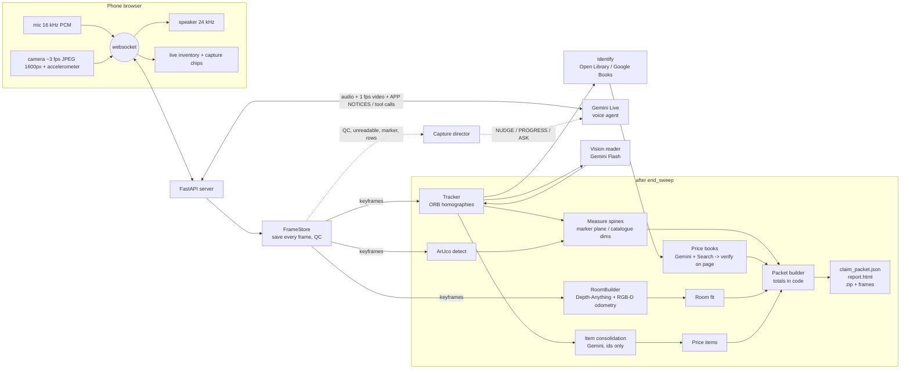

# Architecture (one page)

## Which model does what

| Job | Model | Why this one |
|---|---|---|
| Talk, listen, see roughly (1 fps) | Gemini Live | low-latency voice with tool calls; it directs capture but its own impressions never become packet data |
| Read spines, find objects and bookcases | Gemini Flash (vision, JSON) | one call per keyframe returns boxes for 30-60 thin objects plus verbatim text; transcription only |
| Same object seen in two tracking segments? | Gemini Flash | returns groupings of ids we supply; cannot add facts |
| Find prices | Gemini Flash + Google Search grounding | finds local retailer pages; every number is then checked against the page or the grounding metadata |
| Room depth | Depth-Anything-V2 Metric Indoor Small (25M) | metric indoor depth, runs on a laptop CPU at ~0.5 s/keyframe |
| Everything else | code | geometry, matching, totals, review queue |

## Where metric scale comes from

* **Spines and bookcases:** a printed ArUco marker (15 cm) leaning on the spines. Corners -> exact homography from pixels to cm on the spine plane; homography chaining carries it to all keyframes in the same tracking segment. Fallbacks: catalogue heights of identified books in the same frame (Open Library `physical_dimensions`), a dimension the policyholder states, else empty + review.
* **Room:** monocular metric depth rescaled by the marker (true distance = fx * side / side_px), RGB-D odometry between keyframes, accelerometer gravity for "up" and per-frame tilt correction. Floor and ceiling = extreme dense horizontal bands; walls = outermost point-density peaks; rectangle unless the traced outline fills < 90 % of it (then polygon, with the note in the packet). Wall area is gross perimeter x height. Camera horizontal FOV is calibrated once with `cli calibrate-fov`.

## Where prices come from

Search agent (Gemini + Google Search) proposes offers for the policyholder's market (retailer lists per country in `config.py`). `pricing/verify.py` fetches each offer page and requires the amount next to the currency symbol (or a schema.org price) and the product's words on the page -> `page_text`. If the page blocks us but grounding metadata attributes the sentence with that amount to a retrieved result -> `grounded_snippet` (accepted, flagged for review). Otherwise discarded. Replacement = median of verified NEW offers; used = median of verified USED offers ("Good" condition assumed). No local offers -> other market converted at ECB rate (Frankfurter), labelled `converted`. Rarity cues, offers over the threshold and all art -> `needs_appraisal`, never priced.

## Separate, testable stages

Each stage writes JSON under `sweeps/<id>/stages/` (vision per keyframe, item groups, corrections), and `cli process <sweep> --reuse-vision` re-runs tracking, measurement, identification, pricing, room and packet from saved frames without re-paying for vision.
